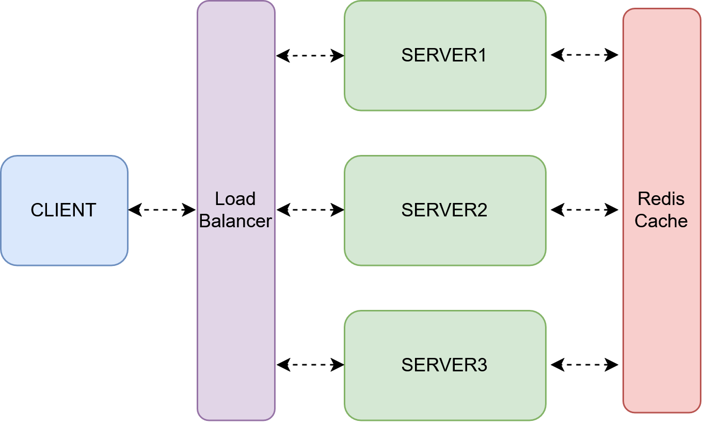

# Containerized Load Balancer Client/Server System

## Description

Python 3.14.7

## Setup Instructions

### Terminal 1: start Redis and the server

docker compose up -d redis
$env:REDIS_HOST="localhost"; python -m server.server

### Terminal 2: run the client
$env:SERVER_HOST="localhost"; python client.py
## Execution Instructions

## Documentation

RPyC: https://rpyc.readthedocs.io/en/latest/

diagram: drawio
https://viewer.diagrams.net/?tags=%7B%7D&lightbox=1&highlight=0000ff&edit=_blank&layers=1&nav=1&dark=auto#R%3Cmxfile%3E%3Cdiagram%20name%3D%22Page-1%22%20id%3D%224qol6sGUmO_Wej9eELGz%22%3E3Vlbd6M2EP41fowP98tj1km6e5r27Gna7vapRwZh2AKiQsR4f31HICxk41sNzp74IUGj0Uj%2BZuabEZ6Zi6z%2BiaIi%2FoWEOJ0ZWljPzIeZYfi6Dn%2B5YNMKbFMIVjQJW1FP8JJ8x0KoCWmVhLhUFBkhKUsKVRiQPMcBU2SIUrJW1SKSqrsWaIX3BC8BSvelX5KQxa3UszUp%2F4iTVdztrGtiJkOdshCUMQrJuicyH2fmghLC2qesXuCUY9fh0q57OjC7PRjFOTtnwac%2Fnr7%2BTJHz0X7%2Bs%2F5ifPtbz5Z3fmsFh3soSLNCVJKKBviIrU6PbTrwuNkXMSSUxWRFcpQ%2BSukHSqo8xPyEGoykzjMhBQh1EH7DjG1EYKCKERDFLEvFLJySbr6K9c3gLz6YG3Y3fqj7sw8bMRKxhOgKsyNfyth6CiIckwyDDVhHcYpY8qqChkSsrbZ6Yuk9pWjTUyhIkrOyZ%2FkzF4CCyBrDFTGz2UaV6trL9OGhPUE36n0VKWrC5YLQ6TJUZB5adl7X9kPoWOztxMszWgKDKD5GabLK4TkAe5iC4BVTlkCO3ouJLAnDNpxwmXwXJ%2BFOFkCDcfvDzH7Yuv0VpZXYc01oODMWPBZwzaIE1rYqsAeue%2F49MwjEkjsegrbiFfNElOy51VWWt6Eo15MoKiF0VT%2BP49nDHCB9JTOXu2gdJwy%2FFKghiDVUAtWDAGu6ICmhzVozRNiLApCXjJJ%2FcG%2FGCTy8jIb8tHj%2B9Pjr72f7JlZJuV23lgy%2B5el6R0eg7WuHvaXgfSm41oiMa7xHxjXfgnFtbdD9hwj3uPpEfOtcybfWD8G33Pn8yE%2F8KM0zGKlSNhbr6pZlqbx5Klakdw%2BsmI5pnfdKBiNxgf0mXLBTCnTvBBkc15%2BIDdwr2cD5IdiAYhTya9mIbZfmdHfOzXnxIR06fcIb3rvJeH2SjL%2FE56P3ZoZ%2FZVJ17n3jrCJBUFE4aoDLUbIKmjvN8c9OI7HKu1UVNQ6n0Ej3FRt7oTV0X%2FGMpek4Qz44G3jlpmIN3FQs9aZiWmq5ce2JssGcGtbIC3AweA1cerZla0Ow%2FobDBIJaW6AgPr9k9DF2BiA2VIgd40YQ25NDHEXGMMShs3Tswcjl70FETQakHZTxLfJlWUjlyRHX7anu311mnlWB36iXnvu%2Bs3O51vUT9bUZfcY0AZh4QWmFdcK4Rd4WAR%2B3AlGvXVeMpUE%2B2PQGu%2BaurM3DZcLR3bnuy4%2BnBgIUH81SbbaNkTBzpDG3XH%2Fu9z%2FWnmnL0uRn5wVd26vsbTNa1TKvbTaG%2B79bNxtAEXB7B%2BYhDfbyNM6%2FFekm7som6u9BQdeKurHTzcPTiv%2FPCV9fwBH4925eEMw4SFrTzohupt0LZtvt2pWjNDk8RzT7CNMPB9nN3hUY4xeLPV9CSAQVQARFAmCPJPb4klayz%2F3mae437R3udyfjfucWEDaNCaR1llU5JBlLSP7%2FoLMvh85w51P1Kt3PEVOCl%2BRFxXMrRjnwEb0VbN7lmMFQ%2FnTbprj8%2Fdt8%2FA8%3D%3C%2Fdiagram%3E%3C%2Fmxfile%3E

report: overleaf